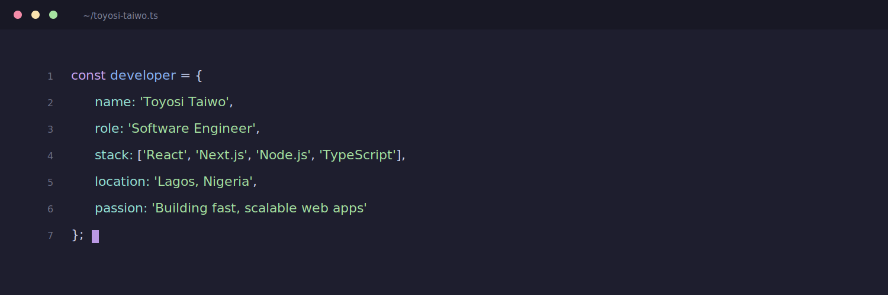

### Hi, I'm Toyosi 👋

**Software Engineer based in Lagos, Nigeria.** I build fast, scalable web applications with React, Next.js, and Node.js — and I care about the numbers behind them: page-load times, conversion rates, server uptime.

🔭 Currently building production web platforms and managing enterprise infrastructure at **BetaPlus International Synergy**
🌱 Sharpening my skills in **TypeScript, Next.js App Router, and system design**
🌐 Portfolio → [toyositaiwo.vercel.app](https://toyositaiwo.vercel.app)

---

### 🚀 Featured Projects

**[BetaPlus International](https://betaplusint.com)** — IT Analyst & Web Developer
Corporate website and digital presence for BetaPlus and its subsidiaries. Built and maintained the front end with a focus on performance, achieving **40% faster page-load times** and a smoother user experience across all subsidiary sites.

**[Dinero Apartments](https://dineroapartments.com)** — Front-End Lead
Real-time short-term rental booking platform. Integrated RESTful APIs for live availability and payment processing; optimised front-end performance through state management, lazy loading, and image compression.

**[OlAAN Global](https://olaanglobalassociates.com)** — Full-Stack Developer
A global education platform for learners, educators, and institutions. Built the front end in React + TypeScript and a high-availability back end with Node.js, Express, and MongoDB. Caching strategies cut server response latency significantly.

> Across these projects: **40% improvement in page-load times** and **20% lift in client conversion rates.**

---

### 🛠️ Tech Stack

**Languages**

**Front-End**

**Back-End**

**Tools & DevOps**

---

### 📊 GitHub Activity

---

### 📫 Connect

📬 **adekunletaiwo43@yahoo.com** · ttoyosi65@gmail.com
